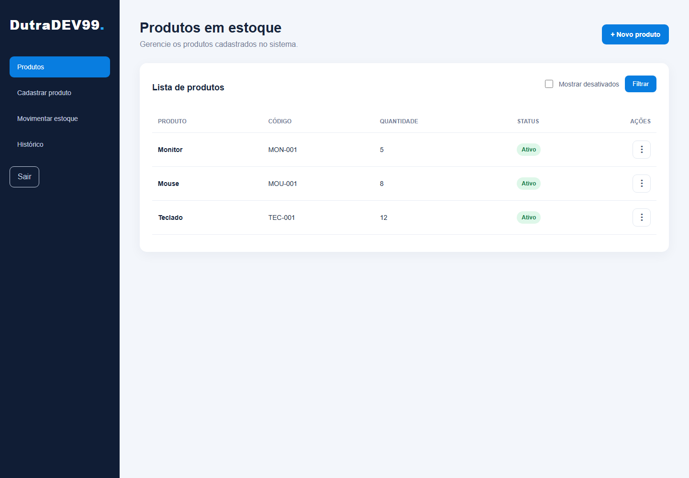

# Wendel Dutra

**Desenvolvimento de Software · Em busca de estágio ou primeira oportunidade como desenvolvedor**

Sou estudante de **Gestão da Tecnologia da Informação na Estácio (2026–2028, conclusão prevista)** e estou em transição para o desenvolvimento de software. Atuo desde **2017** com hardware, manutenção de computadores e suporte técnico em negócio próprio, a [Cyber Computadores](https://www.instagram.com/cyber_computadores/). Após encerrar a loja física, continuo realizando atendimentos enquanto priorizo os estudos e a transição para desenvolvimento.

Tenho aplicação prática de Python e Django no desenvolvimento web e abertura para aprender novas linguagens, ferramentas e áreas de atuação. Neste perfil, apresento projetos com código, documentação e testes para demonstrar o que estou construindo e aprendendo.

## Projetos em destaque

### [DutraDEV — dashboard de análise de receita](https://github.com/DutraDEV99/dutradev-dashboard)

Dashboard interativo para explorar vendas, clientes e desempenho de um negócio, com demonstração pública que pode ser acessada sem cadastro.

**O que o projeto demonstra:**

- Quatro telas responsivas: visão geral, transações, clientes e insights.
- Indicadores calculados a partir das transações, com comparação entre períodos de 7, 30 e 90 dias.
- Gráficos SVG, busca, filtro de status, paginação e exportação CSV.
- Cadastro de transações fictícias com persistência no navegador e atualização dos indicadores.
- Escape de conteúdo digitado e testes de comportamento executados no GitHub Actions.

**Tecnologias:** HTML, CSS, JavaScript, SVG, Node.js para testes e GitHub Pages.

[**Experimentar o dashboard →**](https://dutradev99.github.io/dutradev-dashboard/) · [Ver código e decisões técnicas](https://github.com/DutraDEV99/dutradev-dashboard#readme)

Os dados da demonstração são fictícios. Projeto independente do sistema de estoque abaixo.

### [Case-estoque — sistema de gestão de estoque](https://github.com/DutraDEV99/case-estoque-keener)

Aplicação web para cadastrar produtos, registrar entradas e saídas e acompanhar o histórico de movimentações por usuário.

**O que o projeto demonstra:**

- Autenticação com Django Auth e formulários protegidos por CSRF.
- Validação de estoque insuficiente e bloqueio de movimentações em produtos desativados.
- Gravação de saldo e histórico na mesma transação, com rollback em caso de falha.
- Paginação, busca no histórico e administração com movimentações somente para consulta.
- **18 testes automatizados**, com execução configurada no GitHub Actions.
- Instalação local com SQLite e configuração para PostgreSQL em produção.

**Tecnologias:** Python, Django, SQLite, PostgreSQL, HTML, CSS, JavaScript e GitHub Actions.

[Consultar código e instruções de execução](https://github.com/DutraDEV99/case-estoque-keener#readme) · [Ver testes automatizados](https://github.com/DutraDEV99/case-estoque-keener/actions)

## Conhecimentos

| Área | Conhecimentos e aplicação |
| --- | --- |
| Desenvolvimento web | Python, Django, HTML, CSS e JavaScript; aplicação prática no Case-estoque |
| Dados | SQL, SQLite e MySQL; configuração de PostgreSQL no projeto |
| Qualidade e ferramentas | Testes com Django, Git, GitHub, GitHub Actions e VS Code |
| Fundamentos | C, fundamentos de ciência da computação e inteligência artificial com Python |
| Experiência técnica | Montagem, diagnóstico, manutenção eletrônica de computadores e suporte técnico |

## Formação

- **Gestão da Tecnologia da Informação — Estácio** — **2026–2028**, em andamento, com conclusão prevista para 2028.
- **CS50x — Introduction to Computer Science, Harvard** — concluído com certificado.
- **CS50 AI — Introduction to Artificial Intelligence with Python, Harvard** — concluído com certificado.

## Objetivo profissional

Busco minha **primeira oportunidade em desenvolvimento de software, em estágio ou posição júnior**. Tenho abertura para aprender novas linguagens, ferramentas e áreas de atuação, contribuindo com minha experiência em resolução de problemas e suporte técnico e evoluindo em desenvolvimento, testes e trabalho em equipe.

Rio de Janeiro, Brasil.

[LinkedIn — Wendel Dutra](https://www.linkedin.com/in/wendel-dutra-5258863a9/) · [GitHub — DutraDEV99](https://github.com/DutraDEV99)
